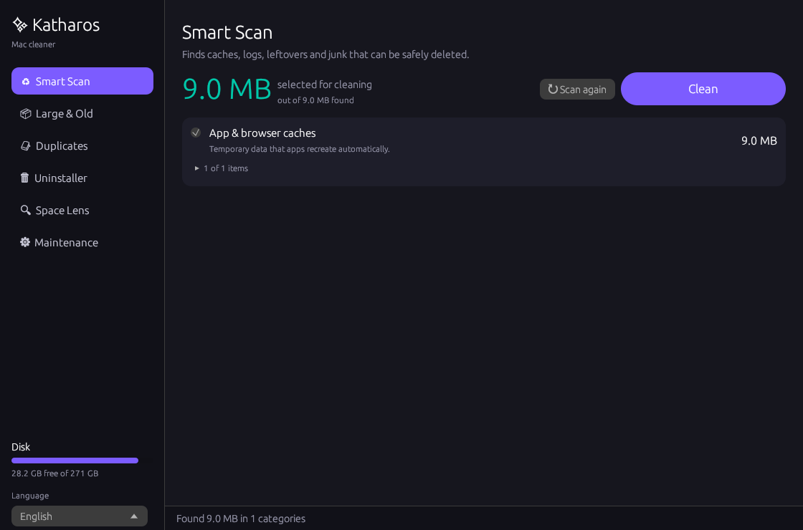

<p align="center">
  
</p>

<h1 align="center">Katharos</h1>

<p align="center">
  A fast, open-source disk cleaner for macOS, written in Rust.<br>
  <em>Katharos (καθαρός) is the Greek word for "clean", "pure" and "clear".</em>
</p>

<p align="center">
  
  
  
</p>

<p align="center">
  
</p>

> [!WARNING]
> Katharos deletes files. **Use it at your own risk and keep a backup (e.g. Time Machine) before cleaning.** The software is provided "as is", without warranty of any kind, and the author accepts no liability for any data loss or damage. See [Disclaimer](#disclaimer).

## What it is

Katharos is a native desktop app in the spirit of tools like CleanMyMac. It finds the clutter that piles up on a Mac over time (caches, logs, leftover app files, forgotten downloads, duplicates) and lets you remove it in a few clicks.

It's written in Rust and scans in parallel on all CPU cores, so even large home folders are scanned in seconds.

### Why "Katharos"?

*Katharos* (καθαρός) is an ancient Greek word that means *clean*, *pure* or *clear*. It shares its root with the English word *catharsis*, which means a cleansing or release.

## Languages

The interface is available in **English, Ελληνικά (Greek), Deutsch (German), Español (Spanish), Italiano (Italian), Français (French) and 中文 (Chinese)**.

- On first launch, Katharos uses your Mac's language if it's one of these.
- You can switch languages at any time with the menu at the bottom of the sidebar. The change takes effect immediately.
- Chinese text uses the system font (PingFang), which is included with macOS.

## Features

| Module | What it does |
|---|---|
| **Smart Scan** | Finds application and browser caches, logs and crash reports, saved application state, Xcode DerivedData and Device Support, npm/Gradle/Cargo caches, Mail attachment copies, and the Trash. Optional: `.dmg`/`.pkg` installers in Downloads and local iPhone/iPad backups. |
| **Large & Old Files** | Lists files above a size you choose, filtered by how long ago you last used them (3, 6 or 12+ months). |
| **Duplicates** | Finds identical files by content (size → partial hash → full BLAKE3 hash). The oldest copy in each group is always kept. |
| **Uninstaller** | Removes an app together with its leftovers in `~/Library`: preferences, caches, containers, saved state, launch agents and more. |
| **Space Lens** | Browses any folder sorted by size, so you can see at a glance what's taking up space. |
| **Maintenance** | Frees purgeable RAM, flushes the DNS cache, reindexes Spotlight, resets Quick Look and rebuilds the Launch Services ("Open With") database. |

### Built-in safety

- Every destructive action asks for confirmation first.
- **Caches and logs** are deleted permanently because apps recreate them automatically. Their folders are emptied, not removed.
- **Your own files** (large files, duplicates, apps, backups) are moved to the **Trash**, so they can be restored.
- A hard-coded safety net blocks any removal outside your home folder (except `.app` bundles in `/Applications`). It also protects key folders such as `~/Documents`, `~/Desktop`, `~/Library` and `~/Library/Caches` themselves.
- Apple system apps, iCloud sync caches and Photos/Music libraries are never touched.

## Installation

Katharos is distributed as source code and built on your own Mac, so no unsigned binaries are downloaded from the internet.

**Requirements:** macOS 11 (Big Sur) or later, on Apple Silicon or Intel.

1. Open **Terminal** (press `⌘ Space`, type *Terminal*, press Enter).
2. Run:

   ```bash
   git clone https://github.com/telemahos/katharos.git
   cd katharos
   bash install.sh
   ```

   No `git`? Click **Code → Download ZIP** on this page, unzip it into Downloads, and run `bash ~/Downloads/katharos-main/install.sh`.

The installer handles the rest:

1. It installs Apple's **Command Line Tools** if they're missing. If a dialog appears, click *Install*, wait for it to finish, then run `bash install.sh` again.
2. It installs **Rust** via [rustup](https://rustup.rs) if it isn't already installed.
3. It compiles Katharos in release mode for your processor.
4. It creates `Katharos.app` with its icon and copies it to `/Applications` (or to `~/Applications` if `/Applications` isn't writable).
5. It launches the app.

The first build takes about 2 to 5 minutes. After that, open Katharos from Launchpad or Spotlight.

### Recommended: grant Full Disk Access

macOS protects some locations, such as Mail data and the Trash. To let Katharos clean them, open
**System Settings → Privacy & Security → Full Disk Access**, click **+** and add **Katharos**.

### Manual build

```bash
cargo build --release
./target/release/katharos          # launch the GUI
./target/release/katharos --scan   # dry run: prints what would be cleaned, deletes nothing
KATHAROS_LANG=de ./target/release/katharos   # start in a given language (el, en, de, es, it, fr, zh)
cargo test                         # runs the test suite in a temporary fake home folder
```

### Updating

```bash
cd katharos
git pull
bash install.sh
```

### Uninstalling

Drag `Katharos.app` from Applications to the Trash.

## Project structure

```
src/
  main.rs    GUI (egui/eframe) and app state
  i18n.rs    translations (7 languages) and language switching
  junk.rs    Smart Scan categories and cleaning
  files.rs   large/old files and duplicate detection
  apps.rs    app listing, leftover detection, uninstall
  lens.rs    folder size browser
  maint.rs   maintenance tasks
  util.rs    parallel size calculation, safe delete, Trash, formatting
  tests.rs   end-to-end tests against a fake home folder
macos/       Info.plist and icon used to build the .app bundle
install.sh   one-step installer
```

## Contributing

Issues and pull requests are welcome. Before opening a PR, make sure `cargo test` passes. If you change what gets deleted, add a test for it.

**Adding or fixing a translation:** all text lives in `src/i18n.rs`. Each entry lists the seven languages in this order: el, en, de, es, it, fr, zh. `{}` marks a value that is filled in at runtime.

## Disclaimer

Katharos is a disk-cleaning tool and, by design, deletes files, moves files to the Trash, uninstalls applications and runs system commands. **You use it entirely at your own risk.**

To the maximum extent permitted by law, the author accepts **no responsibility or liability** for any data loss, damage to your system or hardware, or any other direct or indirect damage resulting from the use of this software. Always review what will be removed before confirming, and keep current backups.

Katharos is an independent project. It isn't affiliated with, endorsed by or connected to MacPaw or CleanMyMac, or to Apple Inc. All trademarks belong to their respective owners.

## License

Released under the [MIT License](LICENSE). See also the full [Disclaimer](DISCLAIMER.md).

A Greek version of this README is available in [README.el.md](README.el.md).
